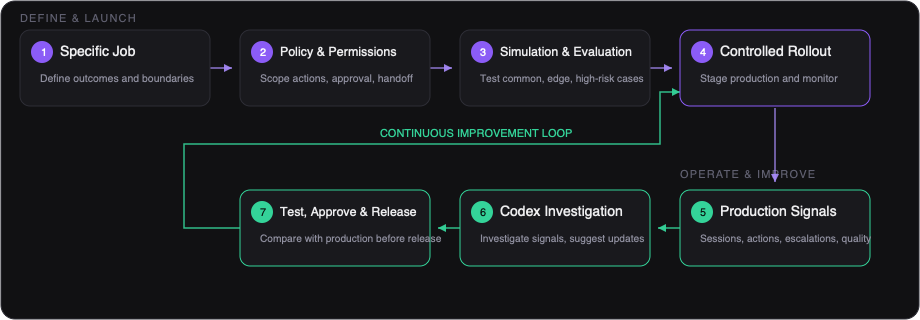
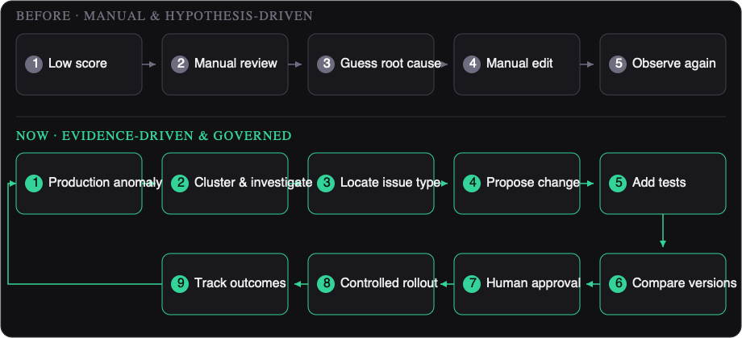
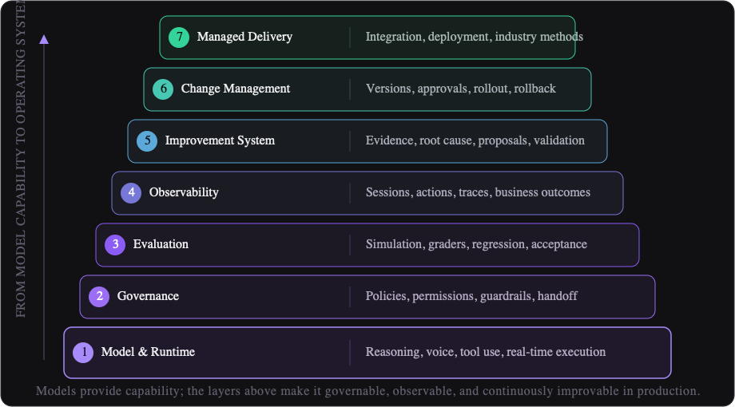

# After OpenAI Presence: Why Enterprise Agent Competition Is Moving from Models to Operating Systems

For the past few years, enterprise discussions about agents have centered on a familiar set of questions: Which model is smarter? Which one reasons better? Which voice sounds more natural? Which one calls tools more accurately?

OpenAI Presence changes the question.

Presence is not framed as another frontier model or another Agent Builder. It presents the enterprise agent as a production system that must be operated over time: start with a specific job, limit knowledge and system access, constrain behavior through policies and approvals, validate the agent through simulation and evaluation, learn from production signals, and move improvements back into production through controlled releases.

Enterprise agent competition is moving from “who has the strongest model” to “who can keep agents reliable, useful, and under control in real operations.”

## Presence changes how enterprises run agents, not merely what agents can do

OpenAI describes Presence as a managed enterprise platform for building, deploying, operating, and continuously improving governed AI agents for high-volume, high-stakes workflows. It currently supports voice and chat, with early use cases including customer support, outbound sales, and high-risk internal workflows.

A Presence agent can answer questions, resolve issues, connect to company systems, take approved actions, and escalate to people when policy, risk, or workflow conditions require human judgment.

None of these capabilities is entirely new by itself. What matters is how Presence organizes them into a production loop:

Jobs and policies define the boundary; production evidence drives testing, approval, and continuous improvement.

This loop suggests that the minimum unit of an enterprise agent product is no longer a prompt, a model call, or a conversation. It is:

A clearly defined job, combined with permissions, policies, evaluations, operational evidence, and a controlled change process.

The model creates capability. The operating system turns that capability into a business outcome for which an organization can take responsibility.

## Starting with a specific job is more production-oriented than pursuing general intelligence

Every Presence deployment begins with a specific job. OpenAI’s examples include:

- resolving billing issues;
- supporting insurance claims;
- handling employee IT service requests;
- understanding a customer request, verifying identity, retrieving account information, applying company policy, and taking an approved action.

The agent receives only the knowledge and system access required for that job. Exact capabilities, integrations, and boundaries are confirmed during technical scoping.

This differs from a typical demo. A demo emphasizes how many questions an agent can answer. A production system first defines the outcome for which the agent is responsible, as well as the conditions under which it must stop, clarify, request approval, or escalate.

Enterprise agent design should begin with four stricter questions:

1. What is the job? What counts as success or failure?
2. Where is the boundary? Which situations are outside the agent’s responsibility?
3. Which actions are allowed? What may the agent read, write, or trigger?
4. When must control return to a person? Which risk, confidence, or policy conditions require human judgment?

The most valuable agent platforms will not make one agent appear capable of everything. They will help enterprises define, replicate, and operate many task-specific agents with explicit boundaries.

## Policies and permissions are execution logic, not peripheral safety features

Presence lets organizations define the policies, standard operating procedures, and escalation rules an agent must follow. The organization decides:

- what the agent may do;
- which actions require approval;
- when a person must take over;
- which knowledge the agent may use;
- which APIs or tools it may access;
- which approved retrieval, update, or execution actions it may complete.

OpenAI’s Help Center further states that permissions are scoped and that production governance may include guardrails, permissions, approval steps, session records, action histories, and human escalation paths.

A policy cannot remain a paragraph buried in a system prompt, and authorization cannot be reduced to whether an API key exists. Both must become executable, auditable, and versioned system objects.

A mature agent operating system should answer:

| Operating question | System object that should answer it |
| --- | --- |
| What may the agent do? | Policies and permissions |
| Which actions require approval? | Approval steps and action boundaries |
| When must a person take over? | Escalation paths and risk conditions |
| Which knowledge may the agent use? | Scoped retrieval and knowledge access |
| Which systems may it access? | APIs, tools, and write permissions |
| What must be recorded? | Session records, action histories, and versioned audit records |

This is not a compliance wrapper around the model. It defines how the agent participates in the enterprise.

## Simulation and evaluation determine whether an agent is qualified to meet real users

Before a Presence deployment reaches users, teams can test it against common requests, edge cases, and higher-risk scenarios. Simulations and graders check:

- whether it reached the right outcome;
- whether it followed policy;
- whether it used tools correctly;
- whether it escalated when appropriate.

The Help Center also lists simulations, evaluations, and acceptance testing. It explicitly states that ingesting documents does not make an agent production-ready; every deployment requires scoping, integration, testing, review, and approval.

This changes the meaning of speed.

The meaningful metric is not how quickly a team can generate a demo that talks. It is how quickly the team can produce credible production evidence:

- how many primary and edge-case workflows are covered;
- which policies have automated evaluations;
- which historical failures have become regression tests;
- how a new version compares with production;
- which remaining risks still require human control.

The next generation of Agent Test products should become an enterprise Eval Registry containing:

- task-success evaluations;
- policy-adherence evaluations;
- tool-use evaluations;
- escalation evaluations;
- high-risk scenario suites;
- historical incident regressions;
- distribution tests across language, channel, and user type.

Models can be replaced. Years of enterprise evaluation assets cannot be reproduced automatically by switching models or platforms.

## Production signals turn launch from an endpoint into a learning loop

Presence uses production sessions, escalations, and quality signals as inputs for improvement. The Help Center also mentions session records and action histories. Teams can use this evidence to understand where the agent works well and where it needs attention.

OpenAI’s published internal example says Presence powers its English-language phone support channel. According to OpenAI, the system met or exceeded its frontline human-support quality benchmarks within weeks, now resolves 75% of inbound issues without human assistance, and reduced human handoffs by 15 percentage points in 10 days through a Codex-powered improvement loop.

These are OpenAI’s results for its own workflow and should not be generalized to other enterprises, industries, or deployments. They nevertheless illustrate an important operating method: agent improvement comes not only from pre-launch design, but also from production evidence.

Production signals should not end in an aggregate dashboard. Evidence that drives improvement must be traceable to the request level:

- the user’s actual intent and language;
- the knowledge loaded for that turn;
- the policy triggered or missed;
- tool parameters, results, and latency;
- the reason a task failed;
- the reason a user requested a person;
- recurring failure clusters;
- whether a change actually improved the business outcome.

When production conversations become searchable, clusterable, and reproducible evidence, the agent becomes a continuously learning business system rather than a one-time implementation.

## The Codex improvement loop is about evidence-to-change, not uncontrolled self-modification

OpenAI states that Codex, using the Presence plugin, investigates production signals and suggests updates. Teams can test proposed changes against the production version and then approve a controlled rollout.

The boundary matters. OpenAI’s public materials describe investigation and suggestions; they do not say Codex bypasses the organization to modify and release the production agent automatically. Testing, approval, and release control remain with the enterprise.

This may be Presence’s most important product signal for the broader agent-platform market.

The shift from a manual linear process to an evidence-driven improvement loop can be summarized as follows:

The new loop begins with production evidence, moves through investigation, testing, approval, and controlled rollout, then returns to outcome tracking.

The value of Agent Operations lies not only in detecting problems, but also in shortening the complete evidence-to-fix cycle while preserving explanation, approval, and rollback.

In iMorph’s product philosophy, Evidence-first Reviewer, Knowledge Gap, Guideline Gap, and Ops Suggestion are not isolated reporting features. They support one verifiable improvement path that connects every recommendation to:

- the knowledge, rule, Journey, or tool that should change;
- the production conversations supporting the recommendation;
- automatically generated regression tests;
- a comparison between old and new versions;
- approval and staged rollout;
- post-release outcome verification.

## Controlled rollout makes agent change look more like software delivery than prompt editing

Presence supports testing proposed changes, approving them, and moving them through controlled rollout. The Help Center also mentions monitoring and rollback processes for new versions.

Any agent change—model, policy, knowledge, tool, workflow, or escalation rule—can affect production behavior. It therefore cannot be treated as a prompt edit that becomes live as soon as someone clicks Save.

Enterprise agents will adopt software-like release discipline, but the release object is broader than code:

| Release object | What must remain controlled |
| --- | --- |
| Model or runtime | Version, evaluation results, and rollback path |
| Policy or Guideline | Scope, approval, and regression impact |
| Knowledge | Source, retrieval behavior, and freshness |
| Tool or permission | Access, parameters, and audit history |
| Workflow or escalation rule | Routing, handoff, and stop conditions |

Over time, enterprises will ask not only, “What is the agent’s accuracy?” but also, “Why is this version allowed to go live, and how do we know it is safer and more effective than the previous one?”

## Managed delivery shows that the last mile still depends heavily on implementation

Presence is currently available through limited GA and is not self-serve. Deployments are led by OpenAI Forward Deployed Engineers, selected partners, or both.

The Help Center describes a typical managed process:

1. define business outcomes, success criteria, and initial workflows;
2. connect systems and encode policies, permissions, and escalation paths;
3. complete security, privacy, and legal review;
4. run simulations, evaluations, and acceptance testing;
5. stage a controlled production rollout and monitor outcomes;
6. review evidence and make tested improvements over time.

Exact features, models, channels, capacity, data handling, pricing, and service commitments are defined for each deployment.

The Presence “product” is not only software. It also includes research, model capability, FDE methodology, system-integration expertise, and ongoing managed delivery.

This raises a broader question for the industry: How can expert-led implementation knowledge become reusable product capability for more enterprises?

If a platform can turn task scoping, SOP decomposition, permission design, simulation scenarios, evaluation gates, launch checklists, and improvement workflows into templates and automation, more enterprises can reproduce production methods at lower cost while retaining operational control.

## After Presence, the enterprise agent capability stack has expanded

Presence shows an enterprise agent capability stack that extends far beyond the model layer:

Models remain critical and will continue to improve. But for enterprise buying decisions, the model increasingly resembles an underlying power system. Whether an agent can enter a high-value workflow depends on whether the six layers above it work together.

The durable moat of an agent platform will increasingly come from operational assets accumulated over time:

- validated job definitions;
- executable policy and permission models;
- industry evaluation suites and incident regressions;
- production conversation and action traces;
- escalation and failure reasons;
- version changes and approval records;
- before-and-after business outcomes;
- operating experience across channels, languages, and regions.

These assets compound with every production run. They do not reset when a new generation of models arrives.

## The iMorph view: Enterprise agents need an operating system teams can control

We believe model capability, expert delivery, and enterprise-controlled operations are complementary rather than competing choices. For an agent to create lasting value, an enterprise needs both reliable intelligence and continuous control over job definitions, operational evidence, and change.

iMorph therefore sees Conversational Agent Operations as a repeatable way of working:

Help teams reach a verifiable agent quickly, turn every real conversation into an asset for operations, optimization, and decision-making, and preserve evidence and control through every change.

This philosophy has four priorities.

### Move from faster demos to faster production evidence

iMorph values a fast cold start while clearly separating:

- quickly generating a testable agent;
- entering production through a governed process.

Speed should come from automated decomposition, templates, simulation, and evidence generation—not from skipping evaluation or approval.

### Make transparency the foundation of automated improvement

Every improvement recommendation should explain:

- why a change is needed;
- which conversations support it;
- whether the root cause is knowledge, policy, workflow, tool, or model;
- which tasks the change affects;
- what improved in evaluation;
- whether production business metrics improved after release.

Enterprises do not need black-box self-optimization. They need improvements that are explainable, approvable, and reversible.

### Turn conversation operations into business intelligence

Production agent data can do more than repair the agent. It can reveal:

- customer needs and topic trends;
- product, knowledge, and workflow gaps;
- the real causes of human handoffs;
- sales opportunities and churn risk;
- behavior differences across channels, languages, and regions;
- the next business opportunities worth funding.

Presence makes the importance of the agent operating layer clearer. iMorph focuses on connecting that layer to business decisions, so improving the agent and understanding the customer become part of the same data loop.

### Make complex implementation methods reusable

Managed delivery solves the last mile for complex deployments. Productization allows successful methods to be repeated by more teams. Turning job templates, industry rules, evaluation methods, launch gates, and improvement workflows into product capabilities helps customer teams build, validate, operate, and expand agents more continuously.

Services and products are not opposites. The better outcome is for every delivery engagement to create methods and capabilities that can be reused in the next deployment.

## Conclusion: Models determine the ceiling; operating systems determine whether enterprises will trust agents

OpenAI’s description of Presence is clear: a production agent requires a specific job, policies and permissions, enterprise-system connections, simulation and evaluation, production monitoring, human escalation, continuous improvement, controlled rollout, and managed deployment support. It is not a self-serve product that becomes production-ready after document ingestion.

This signals a new phase in the enterprise agent market.

The first phase asked whether agents could work. The second asked whether they worked well enough. The next phase will ask:

Who can keep agents completing real tasks reliably as the business changes, while ensuring the enterprise always retains evidence, permissions, and release control?

Models determine the upper bound of agent capability. Operating systems determine whether an enterprise will trust agents with real customers, real data, and real business actions.

After OpenAI Presence, an agent is no longer merely an AI feature. It is becoming a new kind of production system.
